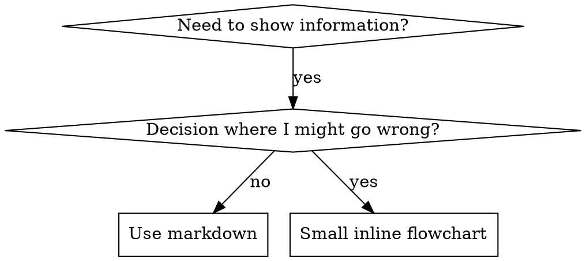

# Skills TDD

## Resumen

**Endurecer una skill ES Test-Driven Development aplicado a documentación de proceso.**

**Las skills personales viven en el directorio de skills de tu runtime** (`~/.claude/skills/` en Claude Code). Codex, Copilot CLI y Gemini CLI también reconocen `~/.agents/skills/` como alias entre runtimes.

Escribes casos de prueba (escenarios de presión con subagentes), los ves fallar (comportamiento base), escribes o ajustas la skill (documentación), ves que las pruebas pasan (los agentes cumplen), y refactorizas (cierras resquicios).

**Principio núcleo:** Si no viste fallar a un agente SIN la skill, no sabes si la skill enseña lo correcto.

**Esta skill asume que la skill a endurecer ya existe.** Si lo que hace falta es crear una skill desde cero, usa `skill-creator`; esta skill entra después, para someterla a presión con subagentes y comprobar que resiste.

## Qué es una skill

Una **skill** es una guía de referencia para técnicas, patrones o herramientas ya probadas. Las skills ayudan a agentes futuros a encontrar y aplicar enfoques efectivos.

**Las skills SÍ son:** técnicas reutilizables, patrones, herramientas, guías de referencia

**Las skills NO son:** narraciones de cómo resolviste un problema una vez

## Mapeo de TDD a skills

| Concepto de TDD | Endurecimiento de skill |
|-------------|----------------|
| **Caso de prueba** | Escenario de presión con subagente |
| **Código de producción** | Documento de la skill (SKILL.md) |
| **La prueba falla (ROJO)** | El agente viola la regla sin la skill (baseline) |
| **La prueba pasa (VERDE)** | El agente cumple con la skill presente |
| **Refactor** | Cerrar resquicios manteniendo el cumplimiento |
| **Escribir la prueba primero** | Correr el escenario baseline ANTES de tocar la skill |
| **Verla fallar** | Documentar las racionalizaciones exactas que usa el agente |
| **Código mínimo** | Ajustar la skill atacando esas violaciones específicas |
| **Verla pasar** | Verificar que el agente ahora cumple |
| **Ciclo de refactor** | Encontrar racionalizaciones nuevas → taparlas → reverificar |

Todo el proceso de endurecimiento de una skill sigue ROJO-VERDE-REFACTOR.

## Cuándo usar esta skill

**Úsala cuando:**
- Ya existe una skill (propia o de terceros) y quieres comprobar que de verdad se cumple bajo presión
- Sospechas que un agente puede encontrarle un resquicio a una skill de disciplina (reglas, obligaciones)
- Vas a hacerle una edición no trivial a una skill existente y quieres verificar que la edición no la debilitó

**No la uses para:**
- Crear una skill nueva desde cero (usa `skill-creator`)
- Documentar una convención específica de un proyecto (va en el archivo de instrucciones del proyecto)
- Restricciones mecánicas (si se puede exigir con regex/validación, automatízalo — guarda la documentación para juicios que requieren criterio)
- Tapar un error o un mensaje confuso de una herramienta propia: primero se arregla el mensaje o el contrato de la herramienta; la skill solo lleva el criterio que la herramienta no puede dar.

## Tipos de skill

### Técnica
Método concreto con pasos a seguir (condition-based-waiting, root-cause-tracing)

### Patrón
Forma de pensar sobre problemas (flatten-with-flags, test-invariants)

### Referencia
Documentación de API, guías de sintaxis, documentación de herramientas (office docs)

## Estructura de directorio

```
skills/
  nombre-skill/
    SKILL.md              # Referencia principal (obligatorio)
    archivo-de-apoyo.*     # Solo si hace falta
```

**Namespace plano** — todas las skills en un único espacio buscable

**Archivos separados para:**
1. **Referencia pesada** (100+ líneas) — documentación de API, sintaxis extensa
2. **Herramientas reutilizables** — scripts, utilidades, plantillas

**Mantener inline:**
- Principios y conceptos
- Patrones de código (< 50 líneas)
- Todo lo demás

## Estructura del SKILL.md

**Frontmatter (YAML):**
- Dos campos obligatorios: `name` y `description` (ver [agentskills.io/specification](https://agentskills.io/specification) para todos los campos soportados)
- Máximo 1024 caracteres en total
- `name`: solo letras, números y guiones (sin paréntesis ni caracteres especiales)
- `description`: en tercera persona, describe SOLO cuándo usarla (NO qué hace)
  - Empieza con "Use when..." / "Usar cuando..." para enfocarte en las condiciones que la disparan
  - Incluye síntomas, situaciones y contextos específicos
  - **NUNCA resumas el proceso o flujo de la skill** (ver la sección SDO para el porqué)
  - Mantenla bajo 500 caracteres si es posible

```markdown
---
name: Nombre-De-Skill-Con-Guiones
description: Use when [condiciones específicas que la disparan y síntomas]
---

# Nombre de la skill

## Overview
¿Qué es esto? Principio núcleo en 1-2 frases.

## Cuándo usarla
[Flowchart pequeño inline SOLO si la decisión no es obvia]

Lista con SÍNTOMAS y casos de uso
Cuándo NO usarla

## Patrón núcleo (para técnicas/patrones)
Comparación antes/después de código

## Referencia rápida
Tabla o viñetas para escanear operaciones comunes

## Implementación
Código inline para patrones simples
Enlace a archivo para referencia pesada o herramientas reutilizables

## Errores comunes
Qué sale mal + cómo arreglarlo

## Impacto real (opcional)
Resultados concretos
```

## Optimización de descubrimiento de skills (SDO)

**Crítico para el descubrimiento:** los agentes futuros necesitan ENCONTRAR tu skill

### 1. Campo description rico

**Propósito:** tu agente lee la description para decidir qué skills cargar para una tarea dada. Que responda: "¿debería leer esta skill ahora mismo?"

**Formato:** empieza con "Use when..." para enfocarte en las condiciones que la disparan

**CRÍTICO: description = cuándo usarla, NO qué hace la skill**

La description debe describir SOLO las condiciones que la disparan. NO resumas el proceso o flujo de la skill en la description.

**Por qué importa:** las pruebas revelaron que cuando una description resume el flujo de la skill, un agente puede seguir la description en vez de leer el contenido completo. Una description que decía "code review between tasks" hizo que un agente hiciera UNA sola revisión, aunque el flowchart de la skill mostraba claramente DOS revisiones (cumplimiento de spec y luego calidad de código).

Cuando la description se cambió a solo "Use when executing implementation plans with independent tasks" (sin resumen del flujo), el agente sí leyó el flowchart y siguió el proceso de revisión en dos etapas.

**La trampa:** las descriptions que resumen el flujo crean un atajo que los agentes van a tomar. El cuerpo de la skill se vuelve documentación que los agentes se saltan.

```yaml
# ❌ MAL: resume el flujo — el agente puede seguir esto en vez de leer la skill
description: Use when executing plans - dispatches subagent per task with code review between tasks

# ❌ MAL: demasiado detalle de proceso
description: Use for TDD - write test first, watch it fail, write minimal code, refactor

# ✅ BIEN: solo condiciones que la disparan, sin resumen del flujo
description: Use when executing implementation plans with independent tasks in the current session

# ✅ BIEN: solo condiciones que la disparan
description: Use when implementing any feature or bugfix, before writing implementation code
```

**Contenido:**
- Usa disparadores, síntomas y situaciones concretas que señalen que esta skill aplica
- Describe el *problema* (condiciones de carrera, comportamiento inconsistente) no *síntomas específicos de un lenguaje* (setTimeout, sleep)
- Mantén los disparadores agnósticos de tecnología salvo que la skill misma sea específica de una tecnología
- Si la skill es específica de una tecnología, hazlo explícito en el disparador
- Escribe en tercera persona (se inyecta en el system prompt)
- **NUNCA resumas el proceso o flujo de la skill**

```yaml
# ❌ MAL: muy abstracto, vago, no incluye cuándo usarla
description: For async testing

# ❌ MAL: primera persona
description: I can help you with async tests when they're flaky

# ❌ MAL: menciona una tecnología pero la skill no es específica de ella
description: Use when tests use setTimeout/sleep and are flaky

# ✅ BIEN: empieza con "Use when", describe el problema, sin flujo
description: Use when tests have race conditions, timing dependencies, or pass/fail inconsistently

# ✅ BIEN: skill específica de una tecnología con disparador explícito
description: Use when using React Router and handling authentication redirects
```

### 2. Cobertura de palabras clave

Usa palabras que un agente buscaría:
- Mensajes de error: "Hook timed out", "ENOTEMPTY", "race condition"
- Síntomas: "flaky", "hanging", "zombie", "pollution"
- Sinónimos: "timeout/hang/freeze", "cleanup/teardown/afterEach"
- Herramientas: comandos reales, nombres de librerías, tipos de archivo

### 3. Nombres descriptivos

**Usa voz activa, verbo primero:**
- ✅ `creating-skills` no `skill-creation`
- ✅ `condition-based-waiting` no `async-test-helpers`

### 4. Eficiencia de tokens (crítico)

**Problema:** getting-started y las skills referenciadas con frecuencia se cargan en CADA conversación. Cada token cuenta.

**Conteo de palabras objetivo:**
- Flujos de getting-started: <150 palabras cada uno
- Skills cargadas con frecuencia: <200 palabras en total
- Otras skills: <500 palabras (aun así, sé conciso)

**Técnicas:**

**Mueve los detalles a la ayuda de la herramienta:**
```bash
# ❌ MAL: documentar todas las flags en el SKILL.md
search-conversations supports --text, --both, --after DATE, --before DATE, --limit N

# ✅ BIEN: referenciar --help
search-conversations supports multiple modes and filters. Run --help for details.
```

**Usa referencias cruzadas:**
```markdown
# ❌ MAL: repetir detalles del flujo
When searching, dispatch subagent with template...
[20 líneas de instrucciones repetidas]

# ✅ BIEN: referenciar otra skill
Always use subagents (50-100x context savings). REQUIRED: Use [other-skill-name] for workflow.
```

**Comprime los ejemplos:**
```markdown
# ❌ MAL: ejemplo verboso (42 palabras)
your human partner: "How did we handle authentication errors in React Router before?"
You: I'll search past conversations for React Router authentication patterns.
[Dispatch subagent with search query: "React Router authentication error handling 401"]

# ✅ BIEN: ejemplo mínimo (20 palabras)
Partner: "How did we handle auth errors in React Router?"
You: Searching...
[Dispatch subagent → synthesis]
```

**Elimina redundancia:**
- No repitas lo que ya está en skills referenciadas
- No expliques lo obvio a partir del comando
- No incluyas múltiples ejemplos del mismo patrón

**Verificación:**
```bash
wc -w skills/ruta/SKILL.md
# flujos de getting-started: apunta a <150 cada uno
# otras cargadas con frecuencia: apunta a <200 en total
```

**Nombra por lo que HACES o la idea núcleo:**
- ✅ `condition-based-waiting` > `async-test-helpers`
- ✅ `using-skills` no `skill-usage`
- ✅ `flatten-with-flags` > `data-structure-refactoring`
- ✅ `root-cause-tracing` > `debugging-techniques`

**Los gerundios (-ing) funcionan bien para procesos:**
- `creating-skills`, `testing-skills`, `debugging-with-logs`
- Activos, describen la acción que estás tomando

### 5. Referencias cruzadas a otras skills

**Al escribir documentación que referencia otras skills:**

Usa solo el nombre de la skill, con marcadores explícitos de obligatoriedad:
- ✅ Bien: `**REQUIRED SUB-SKILL:** Use superpowers:test-driven-development`
- ✅ Bien: `**REQUIRED BACKGROUND:** You MUST understand superpowers:systematic-debugging`
- ❌ Mal: `See skills/testing/test-driven-development` (no queda claro si es obligatorio)
- ❌ Mal: `@skills/testing/test-driven-development/SKILL.md` (fuerza la carga, quema contexto)

**Por qué nada de enlaces `@`:** la sintaxis `@` fuerza la carga inmediata del archivo, consumiendo 200k+ tokens de contexto antes de que lo necesites.

## Uso de flowcharts



**Usa flowcharts SOLO para:**
- Puntos de decisión no obvios
- Bucles de proceso donde podrías parar demasiado pronto
- Decisiones de "cuándo usar A vs B"

**Nunca uses flowcharts para:**
- Material de referencia → tablas, listas
- Ejemplos de código → bloques markdown
- Instrucciones lineales → listas numeradas
- Etiquetas sin significado semántico (step1, helper2)

Ver `graphviz-conventions.dot` en este directorio para las reglas de estilo de graphviz.

**Para visualizarlo con tu compañero humano:** usa `render-graphs.js` en este directorio para renderizar los flowcharts de una skill a SVG:
```bash
./render-graphs.js ../alguna-skill           # Cada diagrama por separado
./render-graphs.js ../alguna-skill --combine # Todos los diagramas en un solo SVG
```

## Ejemplos de código

**Un ejemplo excelente vale más que varios mediocres**

Elige el lenguaje más relevante:
- Técnicas de testing → TypeScript/JavaScript
- Depuración de sistemas → Shell/Python
- Procesamiento de datos → Python

**Un buen ejemplo:**
- Está completo y es ejecutable
- Bien comentado explicando el POR QUÉ
- Sale de un escenario real
- Muestra el patrón con claridad
- Listo para adaptar (no es una plantilla genérica)

**No hagas esto:**
- Implementar en 5+ lenguajes
- Crear plantillas de rellenar-el-espacio
- Escribir ejemplos artificiales

Se te da bien portar código — un gran ejemplo alcanza.

## Organización de archivos

### Skill autocontenida
```
defense-in-depth/
  SKILL.md    # Todo inline
```
Cuándo: todo el contenido cabe, no hace falta referencia pesada

### Skill con herramienta reutilizable
```
condition-based-waiting/
  SKILL.md    # Overview + patrones
  example.ts  # Helpers funcionales para adaptar
```
Cuándo: la herramienta es código reutilizable, no solo narrativa

### Skill con referencia pesada
```
pptx/
  SKILL.md       # Overview + flujos
  pptxgenjs.md   # 600 líneas de referencia de API
  ooxml.md       # 500 líneas de estructura XML
  scripts/       # Herramientas ejecutables
```
Cuándo: el material de referencia es demasiado grande para ir inline

## La ley de hierro (igual que en TDD)

```
NINGUNA SKILL SIN UNA PRUEBA QUE FALLE PRIMERO
```

Esto aplica tanto a skills NUEVAS como a EDICIONES de skills existentes.

Si editaste la skill antes de correr el baseline, descarta esa edición (git) y corre primero el baseline: la edición no probada no cuenta como evidencia.

**Sin excepciones:**
- No para "adiciones simples"
- No para "solo agregar una sección"
- No para "actualizaciones de documentación"
- No conserves cambios sin probar como "referencia"
- No "adaptes" mientras corres las pruebas
- Borrar significa borrar

## Cómo probar cada tipo de skill

Distintos tipos de skill necesitan distintos enfoques de prueba:

### Skills de disciplina (reglas/obligaciones)

**Ejemplos:** TDD, verification-before-completion, designing-before-coding

**Pruébalas con:**
- Preguntas académicas: ¿entienden las reglas?
- Escenarios de presión: ¿cumplen bajo estrés?
- Múltiples presiones combinadas: tiempo + costo hundido + agotamiento
- Identifica racionalizaciones y agrega contramedidas explícitas

**Criterio de éxito:** el agente sigue la regla bajo presión máxima

### Skills de técnica (guías de cómo hacer algo)

**Ejemplos:** condition-based-waiting, root-cause-tracing, defensive-programming

**Pruébalas con:**
- Escenarios de aplicación: ¿pueden aplicar la técnica correctamente?
- Escenarios de variación: ¿manejan casos límite?
- Pruebas de información faltante: ¿las instrucciones tienen huecos?

**Criterio de éxito:** el agente aplica la técnica con éxito a un escenario nuevo

### Skills de patrón (modelos mentales)

**Ejemplos:** reducing-complexity, conceptos de information-hiding

**Pruébalas con:**
- Escenarios de reconocimiento: ¿reconocen cuándo aplica el patrón?
- Escenarios de aplicación: ¿pueden usar el modelo mental?
- Contraejemplos: ¿saben cuándo NO aplicarlo?

**Criterio de éxito:** el agente identifica correctamente cuándo/cómo aplicar el patrón

### Skills de referencia (documentación/APIs)

**Ejemplos:** documentación de API, referencias de comandos, guías de librerías

**Pruébalas con:**
- Escenarios de recuperación: ¿encuentran la información correcta?
- Escenarios de aplicación: ¿usan correctamente lo que encontraron?
- Pruebas de huecos: ¿están cubiertos los casos de uso comunes?

**Criterio de éxito:** el agente encuentra y aplica correctamente la información de referencia

## Racionalizaciones comunes para saltarse las pruebas

| Excusa | Realidad |
|--------|----------|
| "La skill es obviamente clara" | Clara para ti ≠ clara para otros agentes. Pruébala. |
| "Es solo una referencia" | Las referencias pueden tener huecos, secciones poco claras. Prueba la recuperación. |
| "Probar es exagerado" | Las skills sin probar tienen problemas. Siempre. 15 min de prueba ahorran horas. |
| "Pruebo si surgen problemas" | Problemas = los agentes no pueden usar la skill. Prueba ANTES de desplegar. |
| "Es muy tedioso probar" | Probar es menos tedioso que depurar una skill mala en producción. |
| "Confío en que está bien" | El exceso de confianza garantiza problemas. Prueba de todos modos. |
| "Con la revisión académica alcanza" | Leer ≠ usar. Prueba escenarios de aplicación. |
| "No hay tiempo para probar" | Desplegar una skill sin probar gasta más tiempo arreglándola después. |

**Todo esto significa lo mismo: prueba antes de desplegar. Sin excepciones.**

## Que la forma encaje con el tipo de falla

Antes de escribir una guía, clasifica la falla del baseline. La forma que blinda un tipo de falla puede, medido, resultar contraproducente en otro.

| Falla del baseline | Forma correcta | Forma incorrecta |
|---|---|---|
| Se salta/viola una regla bajo presión (sabe que debería y aun así lo hace) | Prohibición + tabla de racionalizaciones + red flags (ver Blindaje más abajo) | Guía blanda ("prefiere...", "considera...") |
| Cumple, pero el output tiene la forma equivocada (prompt inflado, veredicto enterrado, spec repetida) | Receta positiva o contrato: declara qué ES el output — sus partes, en orden | Lista de prohibiciones ("no repitas", "nunca narres") |
| Omite un elemento obligatorio de algo que ya produce | Estructural: campo o slot OBLIGATORIO en la plantilla que llenan | Recordatorios en prosa cerca de la plantilla |
| El comportamiento debería depender de una condición | Condicional atado a un predicado observable ("si el brief existe, referéncialo") | Regla incondicional + cláusulas de excepción |

**Por qué las prohibiciones son contraproducentes en problemas de forma:** bajo un incentivo que compite ("que el prompt sea autocontenido"), los agentes negocian con "no hagas X". En pruebas de redacción cabeza a cabeza sobre guías de prompts de despacho, el brazo de prohibición produjo claramente más del contenido no deseado que el brazo de receta (distribuciones completamente separadas), y tendió peor incluso que el control sin guía — haz tu propia micro-prueba en vez de asumir, pero nunca recurras a la prohibición por defecto. Una receta no deja nada que negociar: el output coincide con la forma declarada o no.

**Reglas para la forma que elijas:**
- **Sin cláusulas de matiz.** "No hagas X salvo que importe" reabre la negociación — agregarle una sola cláusula de matiz a una receta que funcionaba la degradó de consistente a ruidosa en las mismas pruebas de redacción. Expresa una excepción real como su propio condicional sobre un predicado observable.
- **Las cláusulas de exención no delimitan.** "Este límite no aplica a bloques de código" igual suprime los bloques de código. Si una parte del output debe estar exenta, reestructura para que la regla no pueda alcanzarla.

## Blindaje de skills contra la racionalización

Las skills que exigen disciplina (como TDD) necesitan resistir la racionalización. Los agentes son inteligentes y encontrarán resquicios bajo presión.

**Alcance:** este set de herramientas es para fallas de disciplina — un agente que conoce la regla y se la salta bajo presión. Para output con forma equivocada u omisión de elementos, el blindaje basado en prohibiciones es contraproducente; usa las formas de "Que la forma encaje con el tipo de falla" en su lugar.

**Nota de psicología:** entender POR QUÉ funcionan las técnicas de persuasión ayuda a aplicarlas de forma sistemática. Ver `persuasion-principles.md` para el fundamento de investigación (Cialdini, 2021; Meincke et al., 2025) sobre autoridad, compromiso, escasez, prueba social y principios de unidad.

### Cierra cada resquicio explícitamente

No te limites a enunciar la regla — prohíbe los atajos específicos:

<Bad>
```markdown
¿Escribiste código antes que la prueba? Bórralo.
```
</Bad>

<Good>
```markdown
¿Escribiste código antes que la prueba? Bórralo. Empieza de nuevo.

**Sin excepciones:**
- No lo conserves como "referencia"
- No lo "adaptes" mientras escribes las pruebas
- No lo mires
- Borrar significa borrar
```
</Good>

### Aborda los argumentos "espíritu vs. letra"

Agrega un principio fundacional temprano:

```markdown
**Violar la letra de las reglas es violar el espíritu de las reglas.**
```

Esto corta de raíz toda una clase de racionalizaciones tipo "estoy siguiendo el espíritu".

### Construye la tabla de racionalizaciones

Captura las racionalizaciones de las pruebas baseline (ver la sección de Pruebas más abajo). Cada excusa que dan los agentes va a la tabla:

```markdown
| Excusa | Realidad |
|--------|----------|
| "Muy simple para probar" | El código simple se rompe. La prueba toma 30 segundos. |
| "Pruebo después" | Que las pruebas pasen después de escrito el código no prueba nada. |
| "Las pruebas después logran lo mismo" | Pruebas-después = "¿qué hace esto?". Pruebas-antes = "¿qué debería hacer?". |
```

### Crea una lista de red flags

Facilita que los agentes se autoevalúen cuando están racionalizando:

```markdown
## Red Flags — DETENTE y empieza de nuevo

- Código antes que la prueba
- "Ya lo probé manualmente"
- "Las pruebas después logran el mismo propósito"
- "Esto es sobre el espíritu, no el ritual"
- "Esto es distinto porque..."

**Todo esto significa: borra el código. Empieza de nuevo con TDD.**
```

### Actualiza el SDO con síntomas de violación

Agrega a la description: síntomas de que estás A PUNTO de violar la regla:

```yaml
description: use when implementing any feature or bugfix, before writing implementation code
```

## ROJO-VERDE-REFACTOR para endurecer skills

Sigue el ciclo de TDD:

### ROJO: escribe la prueba que falla (baseline)

Corre el escenario de presión con un subagente SIN la skill (o con la versión anterior de la skill). Documenta el comportamiento exacto:
- ¿Qué decisiones tomó?
- ¿Qué racionalizaciones usó (textuales)?
- ¿Qué presiones dispararon las violaciones?

Esto es "ver fallar la prueba" — tienes que ver qué hacen los agentes de forma natural antes de tocar la skill.

### VERDE: escribe la skill mínima

Escribe o ajusta la skill para atacar esas racionalizaciones específicas. No agregues contenido extra para casos hipotéticos.

Corre los mismos escenarios CON la skill. El agente debería cumplir ahora.

### REFACTOR: cierra resquicios

¿El agente encontró una racionalización nueva? Agrega una contramedida explícita. Vuelve a probar hasta que sea a prueba de balas.

### Micro-prueba la redacción antes de los escenarios completos

Las corridas completas de escenarios de presión son el filtro final, pero son lentas y caras por iteración. Verifica primero la redacción misma con micro-pruebas:

1. **Una muestra de contexto fresco por llamada** — una llamada directa a la API, o un subagente de un solo turno si no tienes acceso a la API. System prompt = el contexto realista donde va a vivir la guía (la skill completa o la plantilla de prompt, no la guía aislada); mensaje de usuario = una tarea que tiente la falla.
2. **Incluye siempre un control sin guía.** Si el control no exhibe la falla, no hay nada que arreglar — detente, no escribas la guía.
3. **5+ repeticiones por variante.** Las muestras individuales mienten.
4. **Lee manualmente cada coincidencia marcada.** Puntúa de forma programática si quieres, pero los ecos de la plantilla y los contraejemplos citados se disfrazan de aciertos; los conteos automáticos solos sobreestiman tanto el fallo como el éxito.
5. **La varianza es una métrica.** Cuando la guía funciona, las repeticiones convergen en la misma forma. Cinco interpretaciones distintas en cinco repeticiones significa que la redacción no está vinculante — ajústala antes de agregar más palabras.

Las micro-pruebas verifican la redacción; no reemplazan los escenarios de presión para skills de disciplina.

**Metodología de prueba:** ver [testing-skills-with-subagents.md](testing-skills-with-subagents.md) para la metodología completa de pruebas:
- Cómo escribir escenarios de presión
- Tipos de presión (tiempo, costo hundido, autoridad, agotamiento)
- Tapar huecos sistemáticamente
- Técnicas de meta-prueba

## Antipatrones

### ❌ Ejemplo narrativo
"En la sesión 2025-10-03, encontramos que projectDir vacío causaba..."
**Por qué es malo:** demasiado específico, no reutilizable

### ❌ Dilución multi-lenguaje
example-js.js, example-py.py, example-go.go
**Por qué es malo:** calidad mediocre, carga de mantenimiento

### ❌ Código en flowcharts
```dot
step1 [label="import fs"];
step2 [label="read file"];
```
**Por qué es malo:** no se puede copiar y pegar, difícil de leer

### ❌ Etiquetas genéricas
helper1, helper2, step3, pattern4
**Por qué es malo:** las etiquetas deberían tener significado semántico

## DETENTE: antes de pasar a la siguiente skill

Termina el despliegue de cada skill (checklist de abajo) antes de pasar a la siguiente: probarlas en lote esconde cuál regresó.

**NO hagas esto:**
- Endurecer varias skills en lote sin probar cada una
- Pasar a la siguiente skill antes de verificar la actual
- Saltarte las pruebas porque "hacerlo en lote es más eficiente"

**El checklist de despliegue de abajo es OBLIGATORIO para CADA skill.**

Desplegar skills sin probar = desplegar código sin probar. Es una violación de los estándares de calidad.

## Checklist de endurecimiento de skill (adaptado de TDD)

Lleva el checklist como todos.

**Fase ROJO — escribe la prueba que falla:**
- [ ] Crea escenarios de presión (3+ presiones combinadas para skills de disciplina)
- [ ] Corre los escenarios SIN la skill (o con la versión anterior) — documenta el comportamiento baseline textualmente
- [ ] Identifica patrones en las racionalizaciones/fallas

**Fase VERDE — escribe la skill mínima:**
- [ ] El nombre usa solo letras, números y guiones (sin paréntesis/caracteres especiales)
- [ ] Frontmatter YAML con los campos obligatorios `name` y `description` (máx. 1024 caracteres; ver [spec](https://agentskills.io/specification))
- [ ] La description empieza con "Use when..." e incluye disparadores/síntomas específicos
- [ ] La description está escrita en tercera persona
- [ ] Palabras clave a lo largo del texto para la búsqueda (errores, síntomas, herramientas)
- [ ] Overview claro con el principio núcleo
- [ ] Ataca las fallas baseline específicas identificadas en ROJO
- [ ] La forma de la guía encaja con el tipo de falla (ver "Que la forma encaje con el tipo de falla")
- [ ] Para guía que moldea comportamiento: redacción micro-probada contra un control sin guía (5+ repeticiones, cada coincidencia marcada leída manualmente) — N/A para skills puramente de referencia
- [ ] Código inline O enlace a archivo separado
- [ ] Un ejemplo excelente (no multi-lenguaje)
- [ ] Corre los escenarios CON la skill — verifica que los agentes ahora cumplen

**Fase REFACTOR — cierra resquicios:**
- [ ] Identifica racionalizaciones NUEVAS de las pruebas
- [ ] Agrega contramedidas explícitas (si es skill de disciplina)
- [ ] Construye la tabla de racionalizaciones con todas las iteraciones de prueba
- [ ] Crea la lista de red flags
- [ ] Vuelve a probar hasta que sea a prueba de balas

**Chequeos de calidad:**
- [ ] Flowchart pequeño solo si la decisión no es obvia
- [ ] Tabla de referencia rápida
- [ ] Sección de errores comunes
- [ ] Sin narrativa tipo cuento
- [ ] Archivos de apoyo solo para herramientas o referencia pesada

**Despliegue:**
- [ ] Commitea la skill a git (y súbela a tu fork, si aplica)
- [ ] Considera contribuirla de vuelta vía PR (si es útil de forma amplia)

## Flujo de descubrimiento

Cómo los agentes futuros encuentran tu skill:

1. **Encuentra el problema** ("las pruebas son flaky")
2. **Busca skills** (grepea descriptions, navega categorías)
3. **Encuentra la SKILL** (la description coincide)
4. **Escanea el overview** (¿es relevante?)
5. **Lee los patrones** (tabla de referencia rápida)
6. **Carga el ejemplo** (solo al implementar)

**Optimiza para este flujo** — pon los términos buscables temprano y con frecuencia.

---

Adaptado de obra/superpowers — MIT License, © 2025 Jesse Vincent. https://github.com/obra/superpowers
